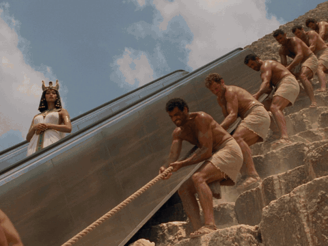
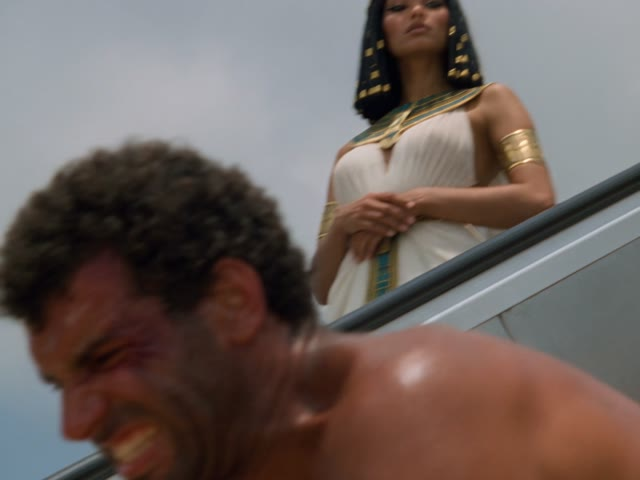
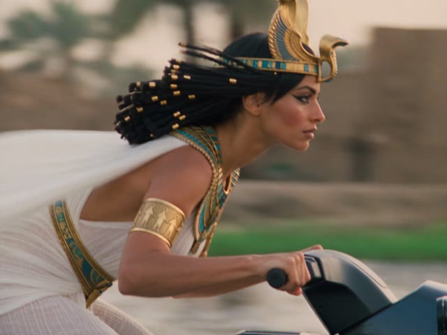
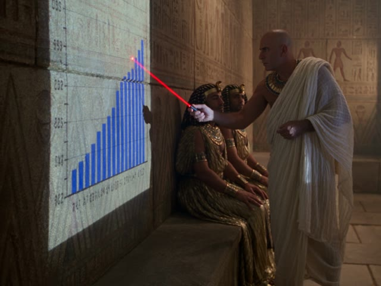
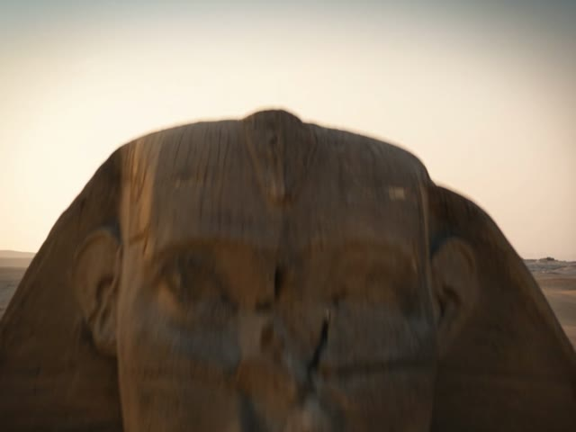
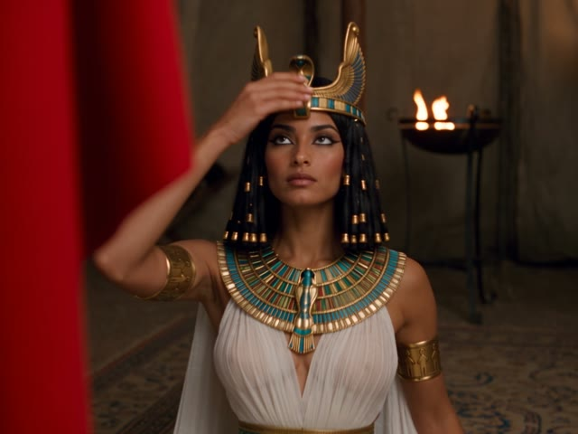

# 埃及艳后的现代日常 · Cleopatra's Modern Life

[中文](#中文) · [English](#english)



**完整成片 / full video:** [`assets/demo.mp4`](assets/demo.mp4)（只有现场声，没有配乐 / clip sound only, no music）

---

## 中文

**埃及艳后的现代日常**：坐扶梯上金字塔、在尼罗河上开水上摩托、骑骆驼买快餐、开卡丁车超过战车、用无人机航拍狮身人面像、从金字塔顶穿翼装飞下来，最后被卷在地毯里快递给罗马将军。8 个镜头全部 AI 生成，全程一本正经，像 90 年代电视纪录片里的重演片段。

这个仓库是它的**完整制作流程**，免费开源：

- **文档**：从拆参考视频、写梗、写提示词到按节拍剪辑，每一步的规则和真实例子
- **8 条真实用过的提示词**，整段复制就能用
- **剪辑脚本**：检查生成的片段、测歌找高潮、按节拍自动剪出 4:3 和 9:16
- **Claude Skill**：装进 [Claude Code](https://claude.com/claude-code) 后说一句「做一期维京首领的现代日常」，它带你一步步做完

### 流程

| 步骤 | 做什么 | 谁来做 | 文档 |
|---|---|---|---|
| 1 | 拆参考视频：逐帧看运镜和表演，写成规律 | Claude / 你 | [00](docs/00-study-reference.md) |
| 2 | 写梗：古代场景 + 现代物件 + 古法对照物 + 结果 | Claude 写，你确认 | [01](docs/01-gags.md) |
| 3 | 出一张人物参考图 | 你在 ChatGPT 出 | [02](docs/02-reference-image.md) |
| 4 | 写镜头和提示词：每条 3 个机位，固定模板 | Claude | [03](docs/03-shots-and-prompts.md) |
| 5 | 即梦 Seedance 生成：只传参考图，不传首帧 | 你 | [04](docs/04-jimeng.md) |
| 6 | 检查片段：机位、时长、乱码、看镜头 | 脚本 + 你 | [04](docs/04-jimeng.md) |
| 7 | 测歌、按节拍剪辑，出 4:3 / 9:16 | 脚本 | [05](docs/05-editing.md) |
| 8 | 发布 | 你 | [07](docs/07-publishing.md) |

### 最关键的一条经验

**不要先出首帧图再图生视频。** 首帧图会让画面太干净、把运镜锁死。只传一张人物参考图，画面、运镜、质感全部用文字写，每条视频写 3 个机位（交代 → 高潮 → 结果）。详见 [踩过的坑](docs/06-pitfalls.md)。

### 8 个镜头

| | | | |
|---|---|---|---|
|  **01 扶梯**<br>金字塔装了扶梯，工人还在拖石头 |  **02 水上摩托**<br>从芦苇船旁边飙过去 |  **03 卡丁车**<br>沙漠里超过马拉战车 |  **04 得来速**<br>骑骆驼到窗口取餐 |
|  **05 投影汇报**<br>祭司汇报尼罗河水位 |  **06 无人机**<br>航拍狮身人面像 |  **07 翼装**<br>从金字塔顶飞下来 |  **08 地毯快递**<br>送给罗马将军 |

提示词：[`examples/cleopatra/prompts/`](examples/cleopatra/prompts/) · 设定和剪辑表：[`examples/cleopatra/episode.json`](examples/cleopatra/episode.json)

### 你需要

- ChatGPT（出人物参考图）
- 即梦会员（Seedance 2.5 网页版）
- 一首歌的音频文件（仓库不提供；发布时也可以在平台音乐库里加）
- 跑脚本：Python 3.9+、ffmpeg、`pip install numpy pillow`
- 剪映（可选，调色）

### 安装成 Claude Skill

```bash
git clone https://github.com/10291124jcjc-dotcom/cleopatra-modern-life.git ~/.claude/skills/cleopatra-modern-life
```

Windows 上把 `~/.claude/skills` 换成 `%USERPROFILE%\.claude\skills`。然后在 Claude Code 里说：

> 做一期维京首领的现代日常

### 只用脚本

```bash
python scripts/setup_check.py my-episode          # 检查环境、建文件夹、复制 episode.json 模板
python scripts/make_prompts.py my-episode         # episode.json → prompts/*.txt
python scripts/review_clips.py my-episode         # 检查即梦生成的片段
python scripts/analyze_music.py my-episode        # 测歌：速度、鼓点进入处、高潮
python scripts/beat_edit.py my-episode            # 按节拍剪辑，出 4:3 / 9:16
```

### 目录

```
SKILL.md                Claude 的操作手册
docs/                   00 拆参考视频 · 01 写梗 · 02 人物参考图 · 03 镜头和提示词 · 04 即梦 · 05 剪辑 · 06 踩坑 · 07 发布
scripts/                setup_check · make_prompts · review_clips · analyze_music · beat_edit
templates/episode.json  空白模板
examples/cleopatra/     埃及女王：设定、8 条提示词、剪辑表
assets/                 预览动图、演示视频、镜头截图
```

### 注意

- 只做古人：不用在世真人、不用近现代政治人物，脸不要做得像任何演员
- 参考别人的视频只学规律，不搬画面、不搬梗
- 画面很像真实纪录片，发布时标注 AI 生成
- 商用歌曲尽量在平台音乐库里加，不要直接压进视频

### 作者

硅基废话（X：[@DDJCXX](https://x.com/DDJCXX) · Instagram：[@mindx1124](https://www.instagram.com/mindx1124)）。做出来的视频欢迎 @ 我。

另一个项目：[古人说唱 Battle](https://github.com/10291124jcjc-dotcom/ancient-rap-battle)

---

## English

**Cleopatra's Modern Life**: she takes an escalator up the pyramid, rides a jet ski on the Nile, grabs a camel drive-thru, overtakes a chariot in a go-kart, flies a drone over the Sphinx, wingsuits off Giza, and finally gets delivered to a Roman general rolled up in a carpet. Eight AI-generated shots, played completely deadpan, looking like a reenactment from a 1990s TV documentary.

This repo is the **full workflow**, free and open:

- **Docs**: rules and real examples for every step, from studying a reference to cutting on the beat
- **The 8 prompts we actually used**, ready to copy
- **Editing scripts**: check generated clips, find the song's chorus, cut to the beat in 4:3 and 9:16
- **A Claude Skill**: install it in [Claude Code](https://claude.com/claude-code), say "make a Viking chief's modern life", and it walks you through

### Steps

1. **Study a reference** frame by frame → camera and acting rules ([00](docs/00-study-reference.md))
2. **Write gags**: ancient setting + modern object + old-way contrast + result ([01](docs/01-gags.md))
3. **One character reference image**, made in ChatGPT ([02](docs/02-reference-image.md))
4. **Shots and prompts**: 3 angles per clip, one fixed template ([03](docs/03-shots-and-prompts.md))
5. **Generate in Jimeng (Seedance 2.5)**: upload the reference only, no first frame ([04](docs/04-jimeng.md))
6. **Review the clips**: angles, length, garbled text, eyes on the lens ([04](docs/04-jimeng.md))
7. **Analyse the song and cut to the beat**, 4:3 and 9:16 ([05](docs/05-editing.md))
8. **Publish** ([07](docs/07-publishing.md))

### The one lesson

**Don't make a first frame and animate it.** It keeps the picture too clean and locks the camera. Upload a single character reference and write picture, camera and look in text, with 3 angles per clip (setup → payoff → result). See [pitfalls](docs/06-pitfalls.md).

### You need

ChatGPT (reference image) · a Jimeng membership (Seedance 2.5 on the web) · an audio file of your song (not included; or add it from the platform's music library) · Python 3.9+, ffmpeg and `pip install numpy pillow` for the scripts · CapCut / Jianying (optional, grading)

### Install as a Claude Skill

```bash
git clone https://github.com/10291124jcjc-dotcom/cleopatra-modern-life.git ~/.claude/skills/cleopatra-modern-life
```

On Windows use `%USERPROFILE%\.claude\skills`. Then tell Claude Code: "make a Viking chief's modern life".

### Scripts only

See the five commands above: `setup_check` → `make_prompts` → `review_clips` → `analyze_music` → `beat_edit`.

### Notes

- Ancient people only: no living people, no modern political figures, no faces that resemble actors
- From other people's videos, learn the rules; never copy footage or gags
- It looks like real documentary footage, so label it as AI-generated
- Add commercial songs from the platform's music library rather than burning them in

### Author

硅基废话 (X: [@DDJCXX](https://x.com/DDJCXX) · Instagram: [@mindx1124](https://www.instagram.com/mindx1124)). Tag me in what you make.

Also by me: [Ancient Rap Battle](https://github.com/10291124jcjc-dotcom/ancient-rap-battle)

## License

Code (`scripts/`): MIT. Docs, prompts and media: [CC BY-NC 4.0](https://creativecommons.org/licenses/by-nc/4.0/). See [LICENSE](LICENSE).
